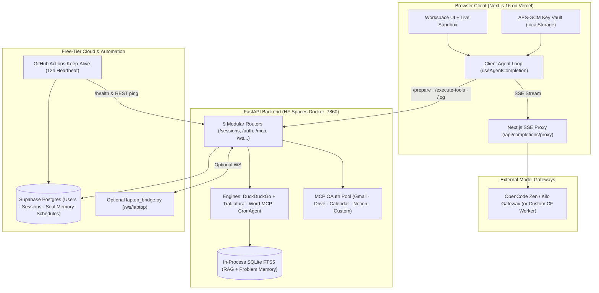

# VoxKage Web

VoxKage Web is a full-stack agentic AI workspace for the browser, pairing a Next.js client with a FastAPI tool-execution backend. It runs multi-step tool calls, live frontend code sandboxing, formatted `.docx` document authoring, OAuth-connected productivity integrations, persistent memory, and scheduled background tasks—engineered on a **Zero-OpEx architecture** that eliminates recurring server, vector-database, and token-billing costs.

Live application: [voxkage.vercel.app](https://voxkage-ai.vercel.app)

---

## Zero-OpEx Architecture

Most hosted AI applications fail financially or hit hard quota walls because the server pays for LLM inference, holds long-lived streaming connections open, runs heavy embedding models in RAM, and rents managed vector databases. VoxKage Web removes those bottlenecks by shifting state, keys, and orchestration to free-tier boundaries:

1. **BYOK with Client-Side AES-GCM Encryption**
   - Users supply their own **OpenCode Zen** (`opencode.ai/zen/v1`) and/or **Kilo Code Gateway** (`api.kilo.ai/api/gateway`) API keys during onboarding (`src/components/OnboardingView.tsx`), unlocking free-tier frontier models (`deepseek-v4-flash-free`, `mimo-v2.5-free`, `stepfun/step-3.7-flash:free`) alongside Gemini 3.5 Flash and Claude Sonnet 4.
   - Keys are encrypted in the browser with **Web Crypto AES-GCM** (`src/lib/secureStorage.ts`) using a device-scoped seed before storage in `localStorage`. The platform operator incurs zero LLM token billing.

2. **Client-Orchestrated Agent Loop & Stateless Backend Turns**
   - In the primary web execution path (`src/hooks/useAgentCompletion.ts`), the browser orchestrates the multi-turn agent loop (up to 12 tool iterations) and streams completions through a stateless Next.js Route Handler (`src/app/api/completions/proxy/route.ts`) or an optional user-hosted Cloudflare Worker (`voxkage_custom_proxy_url`).
   - FastAPI executes only short, stateless bursts:
     - `POST /sessions/{id}/prepare` — loads history, Soul memories, active MCP schemas, and parsed attachments.
     - `POST /sessions/{id}/execute-tools` — runs requested tool calls concurrently and returns structured widget/source metadata.
     - `POST /sessions/{id}/log` — persists the assistant response and virtual workspace files.
   - Keeping long-running LLM streams off the Python backend avoids free-tier worker timeouts and memory saturation. A full-backend WebSocket loop (`/ws/chat/{session_id}`) remains available for legacy/socket sessions and background cron execution.

3. **Zero-Cost RAG, Search, Media, and Email Relays**
   - **SQLite FTS5 instead of Vector Databases**: `backend/rag_engine.py` and `backend/sqlite_db.py` use in-process SQLite FTS5 (`bm25` ranking with `LIKE` fallback) instead of `pgvector` or external vector stores. No embedding model is loaded into memory, keeping RAM usage minimal on free-tier CPU containers.
   - **Web Search & Extraction**: `backend/websearch_engine.py` uses concurrent DuckDuckGo queries (`ddgs`) and `trafilatura` extraction backed by a 15-minute in-memory TTL cache—requiring no paid search APIs.
   - **Image Retrieval**: `backend/image_engine.py` and `backend/image_search_engine.py` resolve images via optional Pexels, DuckDuckGo Image Search, and Pinterest scraping, served through `/api/image-proxy`.
   - **Resilient OTP Delivery**: `backend/auth.py` cascades email verification across Brevo HTTP API, Resend HTTP API, and Gmail SMTP SSL/TLS over cloud-safe ports.

4. **Free-Tier Hosting & Automated Keep-Alive**
   - **Frontend**: Next.js 16 on Vercel.
   - **Backend**: FastAPI Docker container on Hugging Face Spaces (`port 7860`, `backend/Dockerfile`).
   - **Primary Database**: Supabase Postgres free tier for auth profiles, sessions, messages, schedules, and `user_memories`.
   - **Automated Heartbeat**: `.github/workflows/keep_alive.yml` runs every 12 hours (~3% of GitHub Actions' free monthly quota) to ping the HF Space `/health` endpoint (preventing 48-hour sleep), query Supabase REST (preventing 7-day project pauses), and refresh a repository timestamp every 45 days (preventing GitHub's 60-day schedule deactivation).

5. **Optional Residential IP & Local Bridge (`laptop_bridge.py`)**
   - Running `laptop_bridge.py` connects a local machine to `/ws/laptop`, optionally proxying OpenCode/Kilo streams through a residential IP to avoid cloud datacenter rate limits and enabling local desktop tools (`open_application`, `close_application`, `laptop_command`).



---

## Core Capabilities

### Execution Modes & Context Control
- **Plan Mode & Work Mode**: Plan Mode (`src/components/PlanOutputCard.tsx`) generates structured `<plan>` specifications without mutating files or executing search loops. Users can attach inline review comments to a plan and click **Proceed** to execute it in Work Mode with live `<task_list>` tracking.
- **Model & Reasoning Variants**: Supports OpenCode Zen and Kilo models with five presets (`Low`, `Medium`, `High`, `XHigh`, `Max`) that tune temperature, `max_tokens` (`2048` to `32768`), and penalties (`backend/agent_loop.py`).
- **Context Compaction (`/compact`)**: Summarizes long conversation histories into a dense technical brief (`backend/compaction.py`), prunes older messages, and updates the live context window percentage indicator.

### Virtual Coding Workspace & Live Sandbox
- **5-Stage Agentic Coding Pipeline**: `create_code_file`, `read_code_file`, `update_code_file` (supporting `SEARCH/REPLACE` diff blocks), and `verify_code_file`.
- **Automated Syntax Verification**: `verify_code_file` checks bracket and quote balance, HTML tag nesting, JSON validity, Python `compile()`, and runs `node --check` on JavaScript files and `<script>` blocks extracted from HTML with accurate line offsets.
- **Split-Pane File Inspector (`src/components/FileInspectorPanel.tsx`)**: Displays Prism syntax-highlighted code, version switching across edits, line-level comments sent back as targeted context, a multi-file artifact tree, and a live `HTML/CSS/JS/JSX/TSX` iframe preview with a resizable console log terminal.

### OAuth MCP Integrations & Microsoft Word Authoring
- **Connected Apps (`src/components/ConnectModal.tsx`, `backend/mcp_client.py`)**: PKCE OAuth 2.1 with AES-encrypted token persistence (`backend/crypto.py`) and automatic token refresh for **Gmail**, **Google Drive**, **Google Calendar**, and **Notion**, plus custom remote MCP servers over SSE or Streamable HTTP (`backend/mcp_pool.py`).
- **Built-in Microsoft Word MCP (`backend/word_mcp.py`, `src/components/WordDocumentViewer.tsx`)**: Creates and version-edits structured documents (`v1`, `v2`), renders a paginated A4 preview with KaTeX math in the inspector, and exports native `.docx` binaries with LaTeX equations compiled to Word OMML via `backend/MML2OMML.XSL`.

### Dual-Track Memory & Document Parsing
- **User Soul Profile**: Stores persistent user preferences, identity facts, habits, and pre-approved trusted actions in Supabase `user_memories` (`backend/memory_engine.py`).
- **Self-Learning Problem Memory**: Logs encountered bugs, fixes, and prevention rules into SQLite FTS5 (`log_problem`, `log_solution`, `search_memory`).
- **Document Parsing & RAG (`backend/rag_parser.py`, `backend/rag_engine.py`)**: Parses uploaded files up to 50 MB (`PDF`, `DOCX`, `XLSX`, `PPTX`, and plain text/code) and indexes chunks into SQLite FTS5 for scoped or cross-session retrieval.

### Background Cron Scheduler (`/schedule`)
- Typing `/schedule <timing and task>` parses local time (defaulting to IST `+05:30` when unspecified) into a UTC cron expression and presents a confirmation card (`src/components/ScheduleSetupWidget.tsx`).
- `backend/scheduler.py` evaluates active schedules in the background and spawns isolated `CronTaskAgent` loops (`backend/cron_agent.py`) with access to web search, memory, and connected MCP tools.

### Rich Inline Widgets & Security
- **Interactive Response Widgets**: Maps (`Leaflet` / `MapLibre`), analytics charts (`Recharts`), collapsible timelines, weather cards, Mermaid diagrams, KaTeX math, live image search grids, and a consulted-sources drawer.
- **Authentication & Hardening (`backend/auth.py`, `backend/config.py`)**: Email OTP (signup, login, password reset), `bcrypt` password login, Google OAuth, 365-day JWT with hashed refresh-token rotation, CSRF `Origin`/`Referer` validation on `/auth/*`, and per-endpoint rate limiting.

---

## Tech Stack

| Layer | Technologies |
|---|---|
| **Frontend** | Next.js 16 (App Router), React 19, TypeScript, Tailwind CSS 4, PrismJS, Recharts, Leaflet, MapLibre GL, Mermaid, KaTeX |
| **Backend** | Python 3.11, FastAPI, Uvicorn, WebSockets, `httpx`, `ddgs`, `trafilatura`, `python-docx`, `pypdf`, `openpyxl`, `python-pptx`, `latex2mathml`, `lxml`, `mcp` |
| **Storage** | Supabase (Postgres) + In-process SQLite FTS5 (`backend/voxkage_memory.db`) |
| **Model Gateways** | OpenCode Zen (`opencode.ai/zen/v1`) & Kilo Code Gateway (`api.kilo.ai/api/gateway`) |
| **Deployment** | Vercel (frontend), Hugging Face Spaces Docker SDK (backend), GitHub Actions (12h keep-alive) |

---

## Running Locally

### Prerequisites
- Node.js 20+ and npm
- Python 3.11+
- A Supabase project (tables: `sessions`, `messages`, `user_settings`, `user_memories`, `schedules`, `oauth_sessions`, `message_feedback`)
- An API key from [opencode.ai](https://opencode.ai) or [kilo.ai](https://kilo.ai)

### 1. Clone and Install Dependencies

```bash
git clone https://github.com/ayushdwivedi001/VoxKage-Web.git
cd VoxKage-Web

# Frontend
npm install

# Backend
cd backend
pip install -r requirements.txt
```

### 2. Configure Environment Variables

Create `.env.local` in the repository root:

```env
NEXT_PUBLIC_BACKEND_URL=http://localhost:8000
# Optional: enables Google Sign-In button on login screen
NEXT_PUBLIC_GOOGLE_CLIENT_ID=your_google_oauth_client_id
```

Create `backend/.env`:

```env
# Required — backend will not start without these
SUPABASE_URL=https://your-project.supabase.co
SUPABASE_KEY=your_supabase_service_or_anon_key
JWT_SECRET_KEY=generate_a_strong_random_secret

# Optional — CORS & token encryption
ALLOWED_ORIGINS=http://localhost:3000,https://voxkage.vercel.app
TOKEN_ENCRYPTION_KEY=generate_a_fernet_or_32byte_secret

# Optional — server-side fallback keys (used by cron jobs, compaction, or WS loop)
OPENCODE_API_KEY=your_opencode_key
KILO_API_KEY=your_kilo_key

# Optional — OAuth & MCP integrations
GOOGLE_CLIENT_ID=your_google_client_id
GOOGLE_CLIENT_SECRET=your_google_client_secret
NOTION_CLIENT_ID=your_notion_client_id
NOTION_CLIENT_SECRET=your_notion_client_secret

# Optional — Email OTP relays (configure any one for signup/reset emails)
BREVO_API_KEY=
RESEND_API_KEY=
SMTP_SERVER=smtp.gmail.com
SMTP_USERNAME=
SMTP_PASSWORD=
SMTP_SENDER=

# Optional — stock image search before DuckDuckGo fallback
PEXELS_API_KEY=
```

### 3. Start the Application

```bash
# Terminal 1 — FastAPI backend (port 8000)
cd backend
uvicorn main:app --reload --port 8000

# Terminal 2 — Next.js frontend (port 3000)
npm run dev
```

Optional — connect the local laptop bridge to your local backend:

```bash
python laptop_bridge.py --local
```

### 4. Using VoxKage
1. Open [http://localhost:3000](http://localhost:3000) and sign in via Email OTP, Password, or Google OAuth.
2. On first login, enter your OpenCode Zen or Kilo Code API key in the onboarding prompt (keys are encrypted locally with AES-GCM).
3. Choose a model and reasoning variant (`Low`–`Max`), toggle between **Work** and **Plan** mode in the prompt bar, attach documents up to 50 MB, or connect Gmail, Google Drive, Google Calendar, Notion, and Microsoft Word from the connectors menu.
4. Use `/schedule <when> <task>` to create recurring cron automations and `/compact` to compress long conversation histories.

---

## Deployment

| Component | Platform | Setup |
|---|---|---|
| **Frontend** | Vercel | Link the repo to Vercel with `NEXT_PUBLIC_BACKEND_URL` pointing to your backend URL and deploy. |
| **Backend** | Hugging Face Spaces (Docker) | Configure `HF_TOKEN` in `backend/.env` and run `python deploy.py` (syncs secrets and pushes `backend/` to a Docker Space on port `7860`), or deploy `backend/Dockerfile` directly. |
| **Keep-Alive** | GitHub Actions | Add `VOXKAGE_WEB_SPACE_URL`, `SUPABASE_URL`, and `SUPABASE_KEY` to repository secrets to enable the 12-hour heartbeat in `.github/workflows/keep_alive.yml`. |

---

## Project Structure

```text
VoxKage-Web/
├── .github/workflows/
│   └── keep_alive.yml              # 12h HF Space + Supabase heartbeat & 45d repo keep-alive
├── src/
│   ├── app/
│   │   ├── api/completions/proxy/  # Stateless Next.js SSE streaming proxy (OpenCode / Kilo)
│   │   ├── oauth/callback/         # OAuth callback handler
│   │   ├── [sessionId]/            # Direct session route
│   │   ├── layout.tsx              # Root layout, theme boot script, KaTeX styles
│   │   └── page.tsx                # Main application shell
│   ├── components/                 # Chat workspace, FileInspectorPanel, WordDocumentViewer, widgets, modals
│   ├── hooks/                      # useAgentCompletion, useAttachments, useAuth, useChatSessions, usePanelResizer
│   └── lib/                        # api.ts, secureStorage.ts (AES-GCM), modelsHelper.ts, chatHelpers.tsx
├── backend/
│   ├── main.py                     # FastAPI entry point, CORS/CSRF middleware, router registration
│   ├── routers/                    # auth, health, mcp, media, models, schedules, sessions, user, websocket
│   ├── mcp_servers/                # Bundled Gmail, Google Calendar, Google Drive, and Notion MCP handlers
│   ├── agent_loop.py               # Tool execution, virtual file verification, WebSocket agent loop
│   ├── auth.py                     # JWT, refresh tokens, bcrypt, multi-relay OTP delivery
│   ├── compaction.py               # /compact session summarization
│   ├── config.py                   # CORS, CSRF middleware, ConnectionManager, rate limiting
│   ├── cron_agent.py               # Isolated background agent for scheduled tasks
│   ├── crypto.py                   # Encrypted OAuth token helpers
│   ├── database.py                 # Supabase Postgres persistence
│   ├── image_engine.py             # Pexels / DDG image search + verification
│   ├── image_search_engine.py      # Pinterest + research-chip image search
│   ├── kilo_client.py              # Kilo AI gateway client
│   ├── mcp_client.py               # OAuth PKCE & MCP server introspection
│   ├── mcp_pool.py                 # Pooled SSE / Streamable HTTP MCP client connections
│   ├── memory_engine.py            # Soul Profile (Supabase) + Problem/Solution memory (SQLite FTS5)
│   ├── opencode_client.py          # OpenCode Zen client & system instructions
│   ├── opencode_proxy.py           # Laptop WS proxy with direct API fallback
│   ├── rag_engine.py               # SQLite FTS5 document indexing & BM25 querying
│   ├── rag_parser.py               # PDF, DOCX, XLSX, PPTX, and text extraction + chunking
│   ├── scheduler.py                # Cron expression parser & background loop
│   ├── sqlite_db.py                # SQLite FTS5 schema initialization
│   ├── tool_schemas.py             # Function-calling schemas exposed to models
│   ├── websearch_engine.py         # Concurrent DuckDuckGo search + trafilatura fetcher + TTL cache
│   ├── word_mcp.py                 # Microsoft Word MCP + LaTeX-to-OMML .docx exporter
│   ├── Dockerfile                  # Python 3.11 Docker build for port 7860
│   └── requirements.txt            # Backend Python dependencies
├── deploy.py                       # Hugging Face Space & Dataset deployment script
├── laptop_bridge.py                # Optional local WebSocket daemon for residential proxy & OS tools
└── package.json                    # Next.js 16 / React 19 frontend dependencies
```
