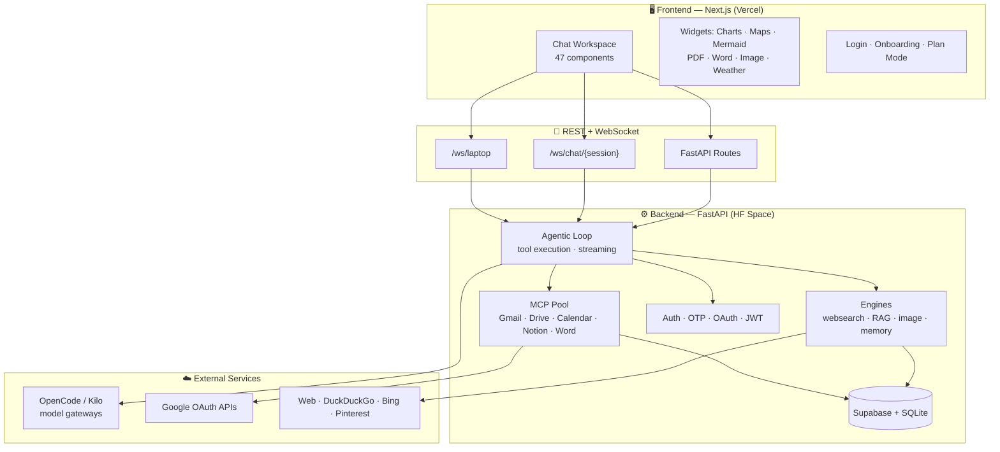

<h1 align="center">VoxKage Web</h1>

<p align="center">
  <b>Your agentic AI workspace in the browser.</b><br/>
  A full-stack, open-source platform that pairs a rich, streaming chat interface with a real agentic backend —
  live tool execution, MCP integrations, RAG memory, web search, image search and more — all under your own keys.
</p>

<p align="center">
  <a href="https://voxkage.vercel.app"></a>
  <a href="https://github.com/ayushdwivedi001/VoxKage-Web"></a>
  <a href="https://github.com/ayushdwivedi001/VoxKage-Web/fork"></a>
  <a href="https://github.com/ayushdwivedi001/VoxKage-Web/issues"></a>
  <a href="LICENSE"></a>
</p>

<p align="center">
  
</p>

---

## 📖 What is VoxKage Web?

**VoxKage Web is a web-based AI assistant platform** — the browser home of the VoxKage AI family. It is *not* a static site: it is a complete, production-grade application where you chat with an AI that can actually **do things** — search the web, query your connected Google accounts, generate documents, draw charts and maps, run scheduled tasks, and persist long-term memory.

Built with a **modern Next.js frontend** and a **Python FastAPI agentic backend**, VoxKage Web streams responses live over WebSockets, executes tools through a modular MCP (Model Context Protocol) pool, and stays cheap by routing through free and affordable model gateways.

> 🎯 **The goal:** a fast, beautiful, private, and extendable AI workspace that anyone can self-host, fork, and make their own.

---

## ✨ Features

| Area | What it does |
|------|--------------|
| 💬 **Streaming chat** | Real-time token streaming over WebSockets, session history, message editing, feedback |
| 🧠 **Agentic tool execution** | Live tool calls rendered as rich interactive cards (charts, maps, mermaid diagrams, file trees) |
| 🔍 **Web search & fetch** | DuckDuckGo search, parallel deep research, article fetching via trafilatura |
| 🧩 **MCP integrations** | OAuth-connected **Gmail, Google Drive, Google Calendar, Notion** + connect your own custom MCP servers |
| 🖼️ **Image engine** | Search & download verified images (Unsplash / Pexels / Pixabay / **Pinterest** / Bing fallback) |
| 🗂️ **RAG memory** | Index documents & codebases, then query them with semantic vector search |
| 👤 **Persistent user memory** | Remembers preferences, habits, and facts about you across sessions |
| 📄 **Document tools** | Create / edit / export **Word** documents, view PDFs and images inline |
| 📅 **Schedules** | Cron-based scheduled tasks with a full setup + management UI |
| 🗺️ **Rich widgets** | Charts (Recharts), maps (Leaflet + MapLibre), Mermaid flowcharts, KaTeX math, timelines, weather |
| 🔐 **Full auth** | Email OTP (multi-relay), password, Google OAuth, JWT refresh, rate limiting, CSRF origin validation |
| 🧑‍💻 **Multiple models** | Switch between **DeepSeek V4 Flash**, **Gemini**, **Claude Sonnet**, **Mimo** and Kilo-powered models |

---

## 🧰 Tech Stack

<p align="center">
  
  
  
  
  
  
  
  
  
  
</p>

| Layer | Technology |
|-------|-----------|
| **Frontend** | Next.js 16 (App Router), React 19, TypeScript, Tailwind CSS 4, Recharts, Leaflet, MapLibre, Mermaid, KaTeX |
| **Backend** | Python 3.11, FastAPI, Uvicorn, WebSockets, SQLite (RAG/memory), Supabase (Postgres) |
| **AI gateways** | OpenCode AI (`opencode.ai/zen/v1`) + Kilo AI (`api.kilo.ai`) — DeepSeek V4 Flash, Gemini, Claude, Mimo, Kilo |
| **MCP servers** | Gmail, Google Drive, Google Calendar, Notion + arbitrary custom MCP |
| **Infra** | Vercel (frontend), Hugging Face Spaces with Docker (backend) |

---

## 🏗️ Architecture

VoxKage Web is split into **two independently deployable halves** connected over HTTP + WebSockets.



### How the pieces talk to each other

1. **You chat** in the Next.js UI → requests go to the FastAPI backend via **REST** (sessions, auth, files) and **WebSockets** (live streaming).
2. The **agentic loop** (`backend/agent_loop.py`) takes your prompt, history, and the chosen model, then streams the model's response *and* executes any **tool calls** it makes — using a real **MCP tool pool**.
3. Tools are rendered back in the UI as **rich interactive cards** — a mermaid diagram renders, a map drops a pin, a Word doc gets created, a schedule gets saved.
4. The backend keeps **long-term state**: Supabase for users/sessions, SQLite for RAG + memory. Everything is auth-scoped to your account.

---

## ⚙️ Backend Deep-Dive

The backend (`backend/`) is the heart of VoxKage Web:

```
backend/
├── main.py                 # FastAPI app — all REST + WebSocket routes (~2.2k lines)
├── agent_loop.py           # Agentic streaming loop + tool execution (~1.6k lines)
├── auth.py                 # JWT tokens, password hashing, current-user dependency
├── database.py             # Supabase client + session/schedule persistence
├── sqlite_db.py            # Local SQLite for runtime state
├── crypto.py               # Encryption helpers
├── websearch_engine.py     # DuckDuckGo search + fetch (trafilatura)
├── rag_engine.py           # Vector RAG + scoped search over indexed docs
├── rag_parser.py           # Document parser (PDF/DOCX/XLSX/PPTX → chunks)
├── image_engine.py         # Verified image search & download
├── image_search_engine.py  # Pinterest + Bing image search adapters
├── memory_engine.py        # Persistent user memory (preferences, habits)
├── opencode_client.py      # OpenCode model gateway client
├── opencode_proxy.py       # Proxy adapter for the OpenCode endpoint
├── kilo_client.py          # Kilo AI gateway client
├── mcp_client.py           # Generic MCP client
├── mcp_pool.py             # Pooled MCP connections per user/provider
├── tool_schemas.py         # Tool JSON-schemas exposed to the agent
├── scheduler.py            # Cron scheduler for scheduled tasks
├── cron_agent.py           # Agentic cron runner
├── compaction.py           # Session context compaction
├── word_mcp.py             # Word document MCP (create/edit/export)
├── google_tools.py         # Google OAuth helper for MCP providers
├── mcp_servers/            # Bundled MCP servers
│   ├── gmail/              # Gmail MCP
│   ├── google_calendar/    # Google Calendar MCP
│   ├── google_drive/       # Google Drive MCP
│   └── notion/             # Notion MCP
└── requirements.txt        # Python dependencies
```

### API surface (highlights)

| Method | Route | Purpose |
|--------|-------|---------|
| `POST` | `/auth/send-otp` · `/verify-otp` | Email OTP login |
| `POST` | `/auth/google` · `/auth/oauth/callback` | Google OAuth login |
| `POST` | `/auth/signup` · `/login-password` · `/reset-password` | Password auth |
| `POST` | `/auth/refresh` | JWT refresh |
| `GET` | `/models` · `/models/kilo` | List available models |
| `POST` | `/completions/proxy` | Streams completions through OpenCode / Kilo |
| `POST` | `/sessions/{id}/prepare` · `/execute-tools` | Agent payload prep + tool execution |
| `POST` | `/sessions/{id}/log` · `/compact` | Response logging + context compaction |
| `GET` | `/api/search/images` · `/pinterest` | Image search |
| `POST` | `/api/mcp/word/create` · `/edit` · `/export-docx` | Word document tools |
| `GET` | `/mcp/registry` · `/auth/oauth/authorize-url` | MCP provider registry + OAuth |
| `WS` | `/ws/chat/{session_id}` | Live streaming chat |
| `WS` | `/ws/laptop` | Laptop bridge channel |
| `GET` | `/health` | Health check |

### 🔌 MCP integrations

Connect your own Google & Notion accounts (OAuth), or plug in any custom MCP server:

- ✉️ **Gmail** — read, send, reply, manage email
- 🗓️ **Google Calendar** — events & scheduling
- 📁 **Google Drive** — files & folders
- 📝 **Notion** — pages, databases, blocks
- ➕ **Custom MCP** — bring any MCP server via `POST /api/mcp/connect-custom`

---

## 🚀 Getting Started

### 1️⃣ Clone the repo

```bash
git clone https://github.com/ayushdwivedi001/VoxKage-Web.git
cd VoxKage-Web
```

### 2️⃣ Install dependencies

```bash
# Frontend
npm install

# Backend
cd backend
pip install -r requirements.txt
```

### 3️⃣ Configure environment

Create a `.env.local` (frontend) and a `backend/.env` (backend):

```env
# Frontend (.env.local)
NEXT_PUBLIC_BACKEND_URL=http://localhost:8000
NEXT_PUBLIC_GOOGLE_CLIENT_ID=your_google_client_id   # optional, for Google sign-in

# Backend (backend/.env)
# Supabase (for sessions & users)
SUPABASE_URL=...
SUPABASE_KEY=...
# Model gateway keys
OPENCODE_API_KEY=...
KILO_API_KEY=...
# Email OTP relays (any one works)
BREVO_API_KEY=...
RESEND_API_KEY=...
SMTP_HOST=...
SMTP_USER=...
SMTP_PASSWORD=...
```

### 4️⃣ Run locally

```bash
# Terminal 1 — backend (FastAPI on :8000)
cd backend
uvicorn main:app --reload --port 8000

# Terminal 2 — frontend (Next.js on :3000)
npm run dev
```

Open **[http://localhost:3000](http://localhost:3000)** — sign up or log in, and start chatting. 🎉

---

## ☁️ Deployment

VoxKage Web is designed to be **cheap to host**:

| Piece | Where | How |
|-------|-------|-----|
| **Frontend** | [Vercel](https://vercel.com) | `vercel deploy` — or push to `main` with a Vercel project linked |
| **Backend** | [Hugging Face Spaces](https://huggingface.co/spaces) | Docker SDK space — use the included [`deploy.py`](deploy.py) or the `backend/Dockerfile` directly |
| **Database** | Supabase + SQLite | Free tier is plenty |

The live deployment runs the frontend on **Vercel** and the backend on **HF Spaces** at `shinayush-voxkage-web-backend.hf.space`.

---

## 🤝 Contributing

Contributions of all kinds are welcome — features, bug fixes, docs, and ideas! 🚀

### Fork & clone

1. **Fork** the repo (top-right ✳️ button on GitHub).
2. Clone your fork:
   ```bash
   git clone https://github.com/<your-username>/VoxKage-Web.git
   cd VoxKage-Web
   ```
3. Add the upstream remote:
   ```bash
   git remote add upstream https://github.com/ayushdwivedi001/VoxKage-Web.git
   ```

### Branch & commit

```bash
git checkout -b feat/your-awesome-feature
# ...make your changes...
git add .
git commit -m "feat: add your awesome feature"
```

### Open a Pull Request

1. Push your branch: `git push origin feat/your-awesome-feature`
2. Open a PR from your fork to `main` on GitHub.
3. Describe what you changed and why — include screenshots for UI changes.

### Guidelines

- 🧪 **Backend:** keep routes in `main.py` or a router, add type hints, and verify with `python -m py_compile <file>`.
- 🎨 **Frontend:** run `npm run lint`, keep components under `src/components/`, and match the existing design tokens.
- 🔐 **Never** commit real secrets — use env vars only.
- 💬 Be kind — we're building this in the open.

---

## 🗂️ Project Structure

```
VoxKage-Web/
├── src/                     # Next.js frontend
│   ├── app/                 # App Router pages, API routes, OAuth callback
│   ├── components/          # 47 UI components (chat, widgets, modals, creatures)
│   ├── hooks/               # useAuth, useChatSessions, useAgentCompletion, ...
│   └── lib/                 # api client, models, helpers, secure storage
├── backend/                 # Python FastAPI backend
│   ├── main.py              # App + routes
│   ├── agent_loop.py        # Agentic streaming loop
│   ├── mcp_servers/         # Bundled MCP servers
│   ├── ...engines & clients
│   └── requirements.txt
├── deploy.py                # HF Space + dataset deployment script
├── laptop_bridge.py         # Laptop ↔ backend bridge (WebSocket)
└── package.json
```

---

## 📜 License

This project is licensed under the **MIT License** — see the [LICENSE](LICENSE) file for details.

<p align="center">
  <sub>Built with ❤️ by <a href="https://github.com/ayushdwivedi001">Ayush Dwivedi</a> · VoxKage AI</sub>
</p>
